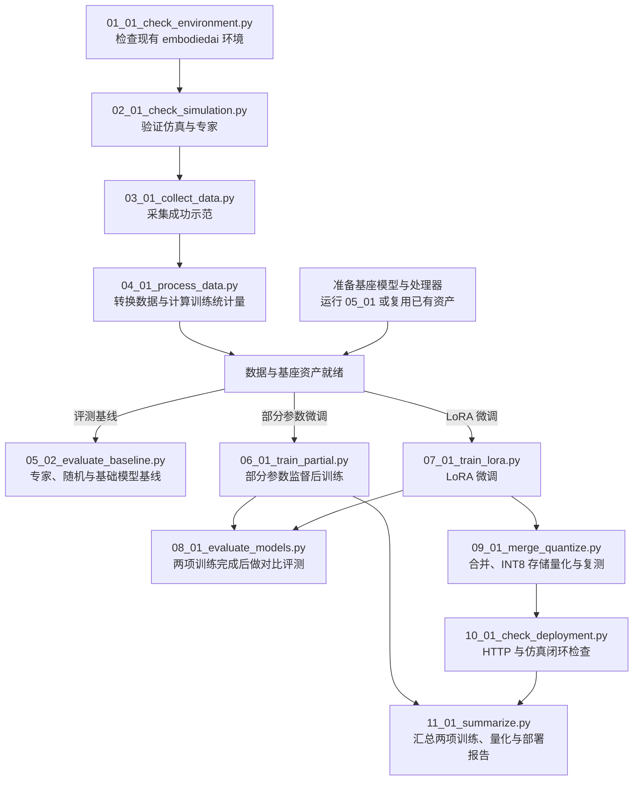
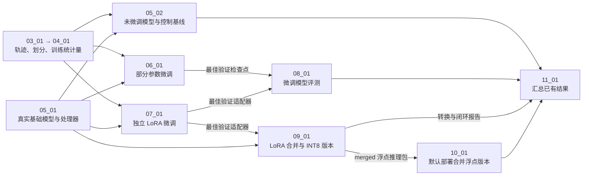
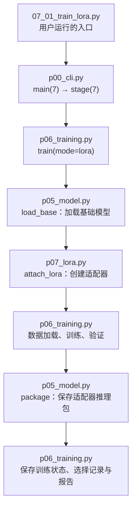

# SmolVLA：Python 文件执行顺序与流程图

本文根据当前 `00_02_run_pipeline.py` 中的 `STEPS` 和 `p00_cli.py` 的实际分派逻辑整理，说明“先运行哪个文件、调用谁、读取什么、产出什么”。**这是代码流程说明，不是训练完成报告。**

## 1. 先自检，再选择运行方式

建议先运行 [00_01_check_structure.py](/Users/zrp/Desktop/lora/smol/smol_workflow/p00_pipeline/00_01_check_structure.py)。它只检查结构、导入、参数和模拟调度顺序，不下载、不采集、不训练。

运行 [00_02_run_pipeline.py](/Users/zrp/Desktop/lora/smol/smol_workflow/p00_pipeline/00_02_run_pipeline.py) 可以自动串行执行完整流程。手动执行时，按第 2 节选择所需分支，各阶段复用同一个 `--run-dir` 和配置。

总入口不会自动执行 `00_01` 自检。自动方式与逐步方式不要在同一运行目录中重复执行已经完成的采集或训练。

## 2. 手动执行路径与自动调度顺序

准备好数据和基座模型后，可以按实验目标选择分支。`06_01` 和 `07_01` 各自从同一基座出发，可以分别运行，显存充足时也可以并行。只做 LoRA 时走 `07_01` 分支。要用 `08_01` 对比两种微调方法，则先完成两项训练。

完整自动运行时，总入口按 `STEPS` 串行执行 `01 → 02 → 03 → 04 → 05_01 → 05_02 → 06 → 07 → 08 → 09 → 10 → 11`，遇到失败即停止。基线评测和两项训练在这个列表中的先后次序由总入口安排。

## 3. 每个执行文件的输入与输出

下表的 `<run>` 指 `--run-dir`，例如 `/Users/zrp/Desktop/lora/smol/outputs/lesson_run`。文件链接对应当前项目中的真实入口。

| 顺序    | Python 文件                                                                                                                | 主要输入                               | 成功执行时的主要输出                                                                             |
| ----- | ------------------------------------------------------------------------------------------------------------------------ | ---------------------------------- | -------------------------------------------------------------------------------------- |
| 01_01 | [01_01_check_environment.py](/Users/zrp/Desktop/lora/smol/smol_workflow/p01_environment/01_01_check_environment.py)      | 当前解释器、依赖、配置、设备                     | `<run>/config.json`；`reports/environment.json`、`requirements.lock.txt`、`pip_check.txt` |
| 02_01 | [02_01_check_simulation.py](/Users/zrp/Desktop/lora/smol/smol_workflow/p02_simulation/02_01_check_simulation.py)         | 仿真配置、固定种子、脚本专家                     | `<run>/reports/simulation_goal_0.gif`、`simulation_goal_1.gif`                          |
| 03_01 | [03_01_collect_data.py](/Users/zrp/Desktop/lora/smol/smol_workflow/p03_data_collection/03_01_collect_data.py)            | 专家控制器、采集数量、种子                      | `<run>/data/raw/` 的 PNG、`trajectory.json`、`manifest.json`；专家回放                         |
| 04_01 | [04_01_process_data.py](/Users/zrp/Desktop/lora/smol/smol_workflow/p04_data_processing/04_01_process_data.py)            | 原始轨迹及完整轨迹划分                        | `<run>/data/lerobot/`、`data/stats.json`、`reports/dataset.json`                         |
| 05_01 | [05_01_download_assets.py](/Users/zrp/Desktop/lora/smol/smol_workflow/p05_model_baseline/05_01_download_assets.py)       | 上游模型仓库；已有清单则直接复用                   | **项目目录** `smol/models/base/`、`processor/`、`assets.json`，不写入 `<run>`                    |
| 05_02 | [05_02_evaluate_baseline.py](/Users/zrp/Desktop/lora/smol/smol_workflow/p05_model_baseline/05_02_evaluate_baseline.py)   | 预训练资产、训练统计量、固定测试清单                 | `<run>/models/base/` 的运行描述；`evaluations/expert/`、`random/`、`base/` 的结果                 |
| 06_01 | [06_01_train_partial.py](/Users/zrp/Desktop/lora/smol/smol_workflow/p06_supervised_post_training/06_01_train_partial.py) | 基础模型、训练/验证轨迹和统计量                   | `<run>/models/partial/` 的两个 epoch 检查点、训练状态、进度、`selected.json`、`report.json`            |
| 07_01 | [07_01_train_lora.py](/Users/zrp/Desktop/lora/smol/smol_workflow/p07_lora_finetuning/07_01_train_lora.py)                | **同一基础模型**、同一数据、LoRA 配置            | `<run>/models/lora/` 的两个 epoch 适配器、训练状态、选择记录和报告                                        |
| 08_01 | [08_01_evaluate_models.py](/Users/zrp/Desktop/lora/smol/smol_workflow/p08_evaluation/08_01_evaluate_models.py)           | 两个实验 `selected.json` 指向的检查点、固定测试清单 | `<run>/evaluations/partial/`、`lora/` 的 JSON、回放及评测报告                                    |
| 09_01 | [09_01_merge_quantize.py](/Users/zrp/Desktop/lora/smol/smol_workflow/p09_merge_quantization/09_01_merge_quantize.py)     | 选中的 LoRA 适配器、基础模型及统计量              | `<run>/models/merged/`、`int8/`；`reports/quantization.json`；两个版本的闭环评测                   |
| 10_01 | [10_01_check_deployment.py](/Users/zrp/Desktop/lora/smol/smol_workflow/p10_deployment/10_01_check_deployment.py)         | 真实 `models/merged/` 推理包            | `<run>/reports/deployment.json`、`server.log`、两条指令的 HTTP 闭环 GIF                         |
| 11_01 | [11_01_summarize.py](/Users/zrp/Desktop/lora/smol/smol_workflow/p11_feedback_summary/11_01_summarize.py)                 | 已生成的训练、评测、量化与部署报告                  | `<run>/reports/REPORT.md`、`summary.json`、`failure_cases.json`                          |

注意：

- `05_01` 只负责项目级资产，没有 `--run-dir`、`--config` 或 `--device` 参数。清单存在时直接返回，并不在这一入口重新验收模型。
- 其他主流程入口会通过公共调度模块记录 `<run>/stages/NN.json`，例如 `stages/06.json`。`05_01` 不单独写阶段状态，`stages/05.json` 由 `05_02` 写入。
- `08_01` 实际评测部分参数微调和 LoRA；基础模型结果来自 `05_02`。最终 `11_01` 汇总各版本报告。
- 数据统计量只使用训练轨迹，测试场景不参与训练；最佳 epoch 根据验证损失选择。
- INT8 版本采用权重存储量化，推理时反量化后进行浮点计算，不代表整数计算加速。

## 4. 数据与模型依赖图

此图的箭头表示**使用哪个上游产物**，不是启动脚本的时间顺序。两项训练都使用基础模型；没有“部分参数模型 → LoRA 初始化”的权重继承关系。

阶段 09 还会评测 `merged` 与 `int8`；阶段 10 当前默认部署 `merged`，并不是自动把量化版本替换为默认服务。

## 5. 入口如何调用内部 Python 文件

`_impl/` 中的文件是可导入的实现代码，**不能把它们另列成必须逐个运行的流程步骤**。`p` 前缀让带阶段编号的模块名可以正常导入，`__init__.py` 则由 Python 自动处理。

以阶段 07 为例，实际调用链如下：

图中训练、验证和保存按 epoch 重复两次；同一模块会在不同调用位置出现，所以“模块文件顺序”不能代替“流程入口顺序”。

部署同理：`10_01` 经 `p00_cli.py` 调用 `p10_deployment.check()`，该函数自动在新进程中启动 `p10_server.py`，完成检查后终止子进程。运行部署检查时不需要手动先启动服务器。

# 
